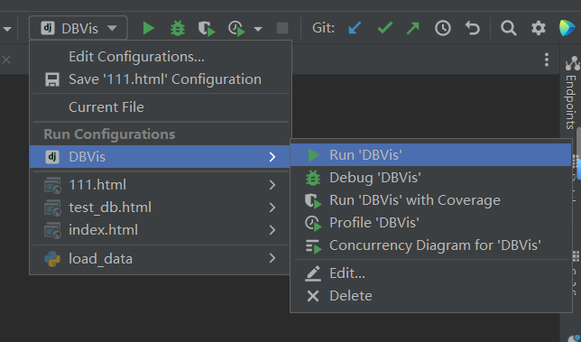
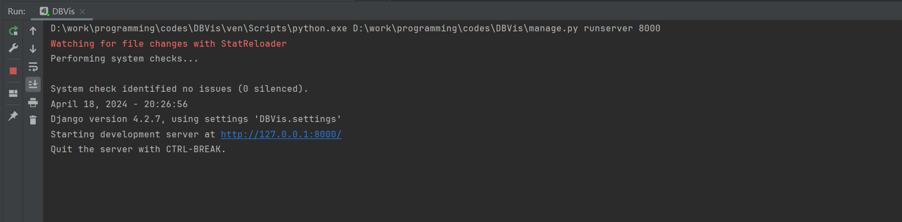
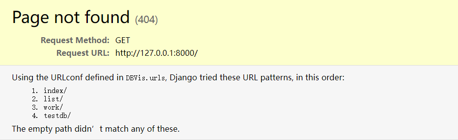
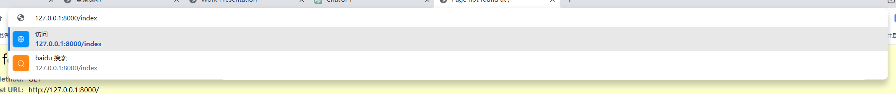
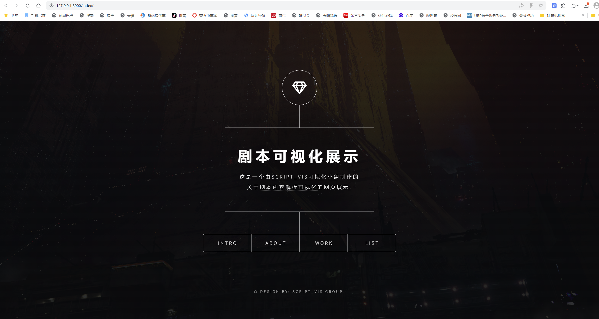

# DBVis User Manual
The native environment is PyCharm Professional version 2023.2.3.
1、Users can click here to start the service:

2、A prompt will appear in the running interface; click the highlighted part to access our website:

3、A browser will pop up, which is normal:

4、At this point, enter /index in the input box, as shown in the figure below, to access the homepage:

5、After entering, our website's homepage will be displayed:

